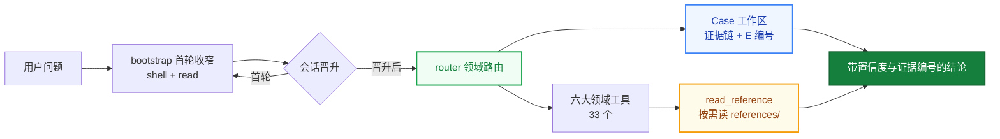

<div align="center">

# helmd

**强证据 · 多参考 · 0 幻觉破甲**

DeepSeek Harness 安全分析插件 —— 一个 preset · 34 个工具 · 362 篇按需参考 · Android / Web / Native / Protocol / Malware / AI-Security 六大领域

[English](README.en.md) | 中文

[](https://t.me/helm_xD)
官方QQ群：**213266664**
[](https://github.com/topics/dsh-plugin)
[](https://github.com/topics/deepseek-harness)
[](https://nodejs.org)
[](https://pnpm.io)
[](LICENSE)

</div>

> 仅供学习交流。使用者须遵守所在地法律法规，对使用本项目产生的后果自负。

## 先说清楚：你要的是哪种破甲

社区里另有一类**引擎补丁路线**工具：直接给已安装的 dsh 宿主落盘补丁，改写引擎裁决代码，把审批/沙箱/升级阶梯这些物理阻断拆掉——不属本项目范畴，另寻对应工具。

helmd 走另一条路：**不碰宿主一个字节**，给模型装纪律。两条路线一句话区分：

> 一句话：补丁拆的是引擎的闸门，helmd 修的是模型的手。

两类可以同装；要可审计、可复现的分析工作流，用 helmd。

## Case 系统：结论不靠猜

传统 AI 安全分析的三个通病：结论一张嘴没有证据、外部 CLI 输出跑完就丢、会话一压缩全忘光。helmd 的 case 系统把「分析过什么」变成磁盘上可审计的事实：

```text
begin_case(goal, samples)
  → 建 helmd-cases/<date>-<slug>/（sample/ evidence/ scripts/ CASE.md）
  → 样本哈希入链，成为第一条证据
        │
        ▼  persist 钩子：33 个领域工具的输出自动落 evidence/，拿 E 编号
        │
record_finding(title, detail, evidence_ids)
  → 强制引用 E 编号；引用不存在的编号 → REJECTED，贴出已知编号清单
  → 先跑出证据，才有资格下结论
        │
        ▼
end_case(summary)
  → deep 档至少 1 条 finding 才许关案
  → evidence/ 里一条 E-xxx 都没有 → REJECTED
  → 确实无证据（纯咨询/被阻塞）必须写明 (no-evidence: 原因)
```

规则写在代码里，不是写在提示词里求模型遵守——`packages/helmd/src/tools/caseflow.ts`。

配套机制：

| 机制 | 行为 |
|------|------|
| 压缩恢复 | 上下文被截断后 `case_status()` 从磁盘 CASE.md 恢复状态；`## resume` 块是跨窗口的交接契约 |
| 外部输出入链 | shell 里跑的第三方 CLI 输出走 `save_evidence(label, ...)` 统一编号，finding 可正常引用 |
| 死路记账 | 同一目标同一战术连败 3 次且无新证据 → `tool_memory note target=deadend`；没有新证据不许重试已归档死路 |
| 关案审计 | 关案即归档：CASE.md 时间线 + findings.md + evidence/ 全清单，接手的人不用重走一遍 |

## 多参考：362 篇文档按需读

知识不塞 system prompt。`skill_catalog` 只做领域/信号路由，`read_reference` 按需读 `references/<domain>/`——Android 脱壳、Frida hook 模板、ConfuserEx 还原、TLS 抓包、LLM 注击 playbook、报告模板……模型读完自主判断，参考是弹药，不是命令。

| 领域 | 参考入口 | 覆盖 |
|------|---------|------|
| Android | `references/android/index.md` | 脱壳、Frida、加固指纹、ARM64 内存 dump、Flutter SSL bypass |
| Web | `references/web/index.md` | 漏洞 playbook、Bot 分析、自动化审计 |
| Native | `references/native/index.md` | 壳识别、ROP、反逆向、JVM 解密 |
| Protocol | `references/protocol/index.md` | PCAP 分析、状态机推断、流量解密 |
| Malware | `references/malware/index.md` | IOC、YARA、家族分析、威胁情报 |
| AI-Security | `references/ai-security/index.md` | 提示注入、越狱方法论、模型防御画像 |
| Evidence | `references/evidence/index.md` | 分诊工作流、报告模板、证据分级 |
| Toolbox | `references/toolbox/index.md` | 工具安装、货架、版本坑位 |

## 0 幻觉：三道闸

1. **证据引用校验**：`record_finding` 引用的每个 E 编号都在磁盘 evidence/ 里验证过，编不出来源的证据 id 直接被拒（见上节）。
2. **完成是外部事实**：关案必须指向磁盘上的证据，或写明为什么没有——不允许「我觉得分析完了」。
3. **反理性化负面清单**：persona 内置基线门禁——高熵样本先验证保护类型再选策略、补丁必须 baseline + 冷启动 + 热启动 + 重复运行四态对比、无证据时明说缺什么而不是补造结论。

advisory 层同步运行：检测上一轮的敷衍/拒绝措辞并注入 stance 指标，敏感输入先归一化为工程术语。

## 架构



`packages/helmd/src/index.ts` 的 `apply()` 按固定顺序组装运行时钩子层，全部寄生宿主 cordis 瀑布，零独立进程、零宿主修改：

```text
tool-wash 描述清洗 → persist 证据链包装 → bootstrap 首轮收窄
  → advisory-hook + llm-stream-hook
  → router + 账本 + caseflow + 工具发现 + 领域工具
```

| 组件 | 职责 |
|------|------|
| `tool-wash.ts` | 把「拒绝是终局」类工具描述话术归一化为可继续措辞（防御层） |
| `persist.ts` | 所有后注册领域工具输出自动落 `evidence/`，软门禁免逐工具改造 |
| `advisory-hook.ts` | 对照会话日志清算上一轮 advisory；检测交付拒绝/敷衍措辞，注入 stance 指标 |
| `model-probe.ts` | `llm_probe` 调用 OpenAI-compatible Chat Completions，记录首段响应、完整响应、分类、状态码与耗时到 JSONL；不采集 reasoning 字段 |
| `llm-stream-hook.ts` | `llm/stream` 拒绝真闭环：拦截 → 历史清洗 → prefill 阶梯嵌套重发 → 末轮诚实透传；计数落审计日志 |
| `ica-context.ts` | L2 行为示范注入：真实形态任务→执行行为对，把生成分布拉向直接交付 |
| `router.ts` + `case.ts` | `skill_catalog`/`read_reference` 路由 + Case 工作区生命周期 |

## 34 个工具

| 域 | 工具 |
|----|------|
| **Case** | `begin_case` `case_status` `record_finding` `save_evidence` `end_case` |
| **路由/知识** | `skill_catalog` `read_reference` `route_task` `analysis_mode`（lite/full/deep 档位） |
| **Android** | `apk_fingerprint` |
| **Web** | `web_reference` `bot_analyze` |
| **Native** | `native_reference` `detect_packer` `scan_strings` `xor_bruteforce` `encoding_detect` |
| **Protocol** | `protocol_reference` `pcap_parse` `state_machine` `parse_har` |
| **Malware** | `malware_reference` `ioc_extract` `yara_gen` |
| **AI-Security** | `ai_reference` `llm_sim` `llm_probe` `llm_eval_suite` |
| **Evidence** | `evidence_reference` `triage_artifact` `hash_artifact` |
| **Toolbox** | `tool_recommend` `find_tool` `tool_memory`（跨会话工具/死路账本） |

## 快速上手

**前提**：已安装 [`dsh`](https://github.com/deepseek-ai/deepseek-harness) CLI 与 pnpm。

Windows（双击 `install.bat`，或 PowerShell）：

```powershell
.\install.ps1
```

macOS / Linux：

```bash
./install.sh
```

安装器会下载最新 Release 的 `helmd.tgz`、装入 profile、写入 preset。**preset 平台行不靠快照复制——安装器在本机上直接读取你已装的 dsh 宿主 `standard` 预设实时派生生成**（`gen-preset.mjs --out`），平台工具行永远匹配你自己装的 dsh 版本。然后：

```bash
dsh web
```

会话里发送 `helmd` 即激活。验证安装：

```bash
dsh --profile web --dump-config                     # 应看到 - id: preset-helmd 与 @adwmc/helm-d/agent
```

会话内快速验证：`skill_catalog` 返回领域路由、`route_task(hint: "分析这个加密APK")` 返回路由依据。

## 安全分析工作台

helmd 0.4.0 起，会话头部 `[helmd 工作台 ▾]` 胶囊按钮就地弹出工作台，三个数据面板经 `/api/helmd/{tools,eval,intercept}` 端点（15s 轮询）实时取数：

- **工具货架**：分类层级树，从 `~/.dsh/helmd-tools/TOOLS.md` 账本动态解析，支持界面直接登记新工具
- **模型评测**：模型响应分类、首段与延迟记录
- **拦截日志**：流式拒绝拦截闭环的计数与摘录

## 从插件商店安装

helmd 已提交 [awesome-dsh-plugin](https://github.com/awesome-dsh-plugin/awesome-dsh-plugin) 收录。命令行等价：

```bash
dsh plugin --profile web add https://github.com/ADWMC/helm-d/releases/latest/download/helmd.tgz
# 或从源码
dsh plugin --profile web add github:ADWMC/helm-d/tree/main/packages/helmd
```

商店安装把包依赖装入 profile；升级过 dsh 宿主后按本机重生成一次 preset：

```powershell
# Windows (PowerShell)
%USERPROFILE%\.dsh\profiles\web\node_modules\@adwmc\helm-d\scripts\setup-preset.ps1
# macOS / Linux
~/.dsh/profiles/web/node_modules/@adwmc/helm-d/scripts/setup-preset.sh
```

## 常用命令

```bash
pnpm install                # 安装依赖（prepare 自动 tsc）
pnpm build                  # 构建 workspace 全部包（发布物仅 helmd）
pnpm typecheck              # 干净树 tsc --noEmit 类型门禁
```

本地打包交付：

```powershell
.\scripts\repack.ps1                                    # 生成 dist-tgz\helmd.tgz
dsh plugin --profile web add .\dist-tgz\helmd.tgz       # 装进 web profile
```

自动更新（比对 GitHub 最新 Release，拒绝降级本地新版）：

```powershell
.\scripts\update.ps1                # 检查并更新 web profile
.\scripts\update.ps1 -CheckOnly     # 只看版本不动手
./scripts/update.sh                 # macOS / Linux
```

## 依赖与宿主 cohort

| 依赖 | peer 范围 | 当前 cohort（overrides 钉死） |
|------|----------|------------------------------|
| `@deepseek-ai/cordis` | `^4.0.2` | `4.0.4` |
| `@deepseek-ai/dsh-tools` / `dsh-settings` | `>=0.1.5-rc.1 <0.2.0-0 \|\| >=0.2.0-rc.1 <0.2.2-0` | `0.2.1-rc.2` 全家 |
| `@deepseek-ai/schemastery` | `^3.18.2` | `3.18.4` |

> **预发布范围的坑**：semver 只在范围里点名同一 `major.minor.patch` 的预发布版本时才收预发布版本。要声明宿主 cohort，必须写成 `>=0.1.5-rc.1 <0.2.0-0` 这种显式双段。`pnpm install` 后 `pnpm peers check` 必须无问题，否则图里混了跨 cohort 的 peer。

## 目录结构

```text
helmd/
├── packages/
│   └── helmd/                 发布包（单 bundle）
│       ├── src/
│       │   ├── bootstrap.ts   首轮工具收窄过滤器
│       │   ├── persist.ts     全工具证据链持久化包装
│       │   ├── case.ts        Case 工作区状态机（磁盘真源）
│       │   ├── tools/caseflow.ts  begin/status/finding/save/end 五工具
│       │   ├── tool-wash.ts   工具描述清洗（防御层）
│       │   ├── advisory*.ts   advisory 账本 + prompt 注入（拒绝/敷衍检测）
│       │   ├── model-probe.ts      OpenAI-compatible 模型评测
│       │   ├── llm-stream-hook.ts  llm/stream 拒绝真闭环与审计
│       │   ├── router.ts      skill_catalog / read_reference 路由
│       │   ├── seam.ts        共享 IO seam（fs / subprocess / 路径校验）
│       │   └── tools/         领域工具模块（34 个工具）
│       ├── client.js          浏览器半：工作台（lazy-CJS，免构建）
│       ├── references/        362 篇参考文档，按需读取
│       ├── scripts/           分析脚本 + ai-security 语料/账本 + gen-preset.mjs
│       ├── presets/           persona 单源 + preset.yml
│       ├── preset.generated.patch.yml  preset 产物（生成物）
│       └── cordis.patch.yml   bundle 挂载清单
├── install.ps1/.sh/.bat       一键安装器
└── docs/                      设计文档与事故复盘
```

> `packages/` 下其余目录为历史拆分包，已由 helmd 单包取代，仅作归档保留、不再发布。

## 构建

需要 pnpm；构建产物目标 ES2022 / NodeNext。

```bash
pnpm install && pnpm build
```

## 发布

- 发布渠道只有 GitHub Release：`adwmc-helm-d-<ver>.tgz` + 稳定别名 `helmd.tgz` + installer 三件套，五件资产缺一不可；npm registry 上的旧包已停止维护，不作为安装来源。
- 版本以 `packages/helmd/package.json` 为准。
- 发布流程、preset 单源同步、坑位表见 [MAINTENANCE.md](MAINTENANCE.md)；版本历史见 [CHANGELOG.md](CHANGELOG.md)。

## 实战案例

**BoosterX v2.2.4.3 (.NET) 许可证绕过** —— helmd 方法论的完整实战验证：

- ConfuserEx 动态防护（anti-tamper dynamic）下活体还原 **32,316 个方法体**、解密 **7,726 条加密常量**，全工程可读化
- 运行时提取 RSA-2048 公钥，定性在线签名授权模型，论证离线伪造不可行
- 三条静态重建死路全部归档根因后，以**零修改、零注入**的官方托管扩展机制完成持久化解锁，UIAutomation + 进程内回读双重实测通过
- 附完整证据链、难度评估与服务端加固建议

📄 全文：[docs/case-studies/boosterx-dotnet-license-bypass.md](docs/case-studies/boosterx-dotnet-license-bypass.md)

## 文档

- [docs/principles.md](docs/principles.md) — 设计原则
- [docs/architecture.md](docs/architecture.md) / [architecture-v2.md](docs/architecture-v2.md) — 架构
- [docs/skillopt-methodology.md](docs/skillopt-methodology.md) — SkillOpt 方法论
- [docs/skills-reference/](docs/skills-reference) — 导入的渗透测试 skill 合并文档

## 致谢

本项目融合了大量优秀开源项目的设计思路与实现模式：

- [ADWMC/helm-x](https://github.com/ADWMC/helm-x) — prompt injection 与评分设计
- [yynxxxxx/Codex-X](https://github.com/yynxxxxx/Codex-X) — 提示词模板与可视化管理
- [dsh-purge](https://github.com/YuJunZhiXue/dsh-purge)（YuJunZhiXue）— 工具描述清洗话术表与输入归一化词表参考了其实现

## Contributing

欢迎提 issue 与 PR。改动前请先阅读 [docs/principles.md](docs/principles.md)，并保持两条架构约束：**证据强制入链、参考知识按需读取**。

## License

本项目基于 [MIT License](LICENSE) 开源，可自由使用、修改和分发。详见 [LICENSE](LICENSE)。

## AI 生成与法律风险

本仓库部分或全部代码由 AI 辅助生成，可能存在错误或不适用场景。使用前请自行审查，并自行判断是否适合你的使用场景与所在司法辖区；使用者须遵守所在地法律，对使用本项目产生的后果自负。本项目按 MIT "原样"提供，不附带任何担保。
